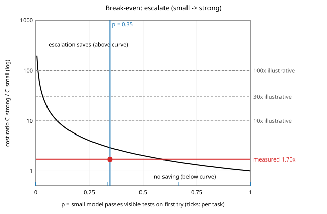

# Escalate or not: small-to-strong model escalation for LLM bug fixing
[](https://github.com/erendarak/Escalate-or-not-small-to-strong-model-escalation-for-LLM-bug-fixing/actions/workflows/ci.yml)

An independent study on a public benchmark.

A bug-fixing agent can start with a cheap model and call a stronger model only when the
visible tests fail. I wanted to know how much repair quality this keeps compared with always
using the strong model, and what it costs. I ran three policies on 26 QuixBugs Python programs
with two local models (Qwen2.5-Coder 1.5B and 7B). The rules were written down and tagged
before the eval run. Under those rules escalation lost: 79.5% resolved against 85.9% for the
strong model alone, at 56% higher estimated cost. A follow-up analysis, done after seeing the
results, found that most of the quality loss came from the hand-off. When the strong model was
shown the small model's wrong code, it did worse. Passing only the test feedback instead
solved 7 escalated runs that the original hand-off failed, and lost none (7 vs 0, exact sign test p = 0.016, exploratory). With these two
models escalation still cannot save money, because the 7B costs only about 1.7 times as much
per call as the 1.5B.

## Results

Eval split: 26 tasks, 3 repeats per task and policy. Resolution means valid output that passes
all visible and all hidden tests, averaged per task and then over tasks. Costs are list-price
estimates for locally run models, computed from measured tokens.

| Policy | Calls | Resolution | Solved | Est. cost | Cost vs strong_only | Median latency | False acceptance |
|---|---|---|---|---|---|---|---|
| strong_only | 7B, then 7B | 85.9% | 67/78 | $0.0085 | reference | 3.7 s | 4% |
| escalate | 1.5B, then 7B | 79.5% | 62/78 | $0.0132 | +56% | 6.3 s | 3% |
| small_only | 1.5B, then 1.5B | 34.6% | 27/78 | $0.0088 | +4% | 4.0 s | 7% |
| escalate_clean (exploratory) | 1.5B, then 7B with test feedback only | 88.5% | 69/78 | $0.0104 | +22% | invalid | 3% |

The first three rows are the pre-registered eval (`results/eval_local_v1`). escalate_clean was
designed after seeing those results, so it is exploratory (`results/escalate_clean_v1`). Its
latency is not reported because another application was using the GPU during that run.

Pre-set decision rule: escalate is acceptable if it loses at most one task (3.8 percentage
points) against strong_only and costs less. It failed both conditions.

Other findings:

- The 7B never copied the small model's code (0 of 51 escalated runs). It made different
  mistakes. On `subsequences` it made the correct one-line fix and then also changed a loop
  bound, which broke the program.
- strong_only was not winning by having two tries. 66 of its 67 solved runs were solved on the
  first call.
- The 1.5B model often returned the buggy program unchanged.
- On `find_in_sorted` the small model's fix passed every visible test and failed a hidden one.
  Routing on visible tests cannot catch this.
- Per-family results (5 bug families, 3 to 7 tasks each) are in the summary files. They are
  descriptive only.

### Break-even

Escalation saves money only if `p * C_strong > C_small`, where `p` is the share of runs in which
the small model passes the visible tests on its first try. In the eval, p = 0.35, so the strong
model would need to cost more than 2.9 times as much per call. The measured ratio was 1.7. The
dashed lines show illustrative 10x, 30x and 100x price ratios, which is closer to the situation
with a frontier API model behind a small one.



## Method

- Tasks: the 31 QuixBugs Python programs that have JSON test cases. Each has one real bug.
  5 are dev tasks used for tuning (one per bug family) and 26 are eval tasks. The split is
  stratified by bug family with seed 2026.
- Tests: up to 3 visible cases are shown to the model, and at least one of them fails on the
  buggy program. The remaining hidden cases are used only for grading.
- Loop: at most two model calls per run. The first call gets the buggy program and the visible
  tests. If the candidate passes the visible tests, the run stops. Otherwise the second call
  also gets the previous candidate and the visible-test failures. Hidden results never reach a
  prompt or a routing decision.
- Output: the model returns the whole corrected file, not a diff. Small models produce malformed
  diffs too often, and that would measure formatting skill instead of repair skill.
- Sampling: temperature 0.2, seed = 2026 + repeat index, the same seed for every policy within
  a repeat.
- Cost: Fireworks serverless size-tier list prices, $0.10 per 1M tokens for the 1.5B model and
  $0.20 for the 7B (source and date in the config files).
- Full protocol, written before the eval: [docs/experiment_protocol.md](docs/experiment_protocol.md).
  Post-hoc analysis: [docs/exploratory.md](docs/exploratory.md).
- History was rewritten once before publishing to remove a private planning file; commit order
  and dates are unchanged.

## Reproduce

Requires Python 3.10 or newer. The fake run and the tests need no model and no GPU.

```bash
python -m venv .venv
source .venv/bin/activate          # Windows: .venv\Scripts\Activate.ps1
pip install -e ".[dev]"
python -m pytest -q                # tests of the evaluator itself, about 2 minutes
python -m routing_pilot.cli run --config configs/dev_fake.yaml
```

The fake run uses a model that always echoes the bug and one that always returns the
reference fix. Expected: small_only 0%, strong_only 100% with 1 call, escalate 100% with
2 calls.

For the real models, install [Ollama](https://ollama.com/download), then:

```bash
ollama pull qwen2.5-coder:1.5b
ollama pull qwen2.5-coder:7b
python -m routing_pilot.cli check --config configs/dev_local.yaml   # both models should answer
python -m routing_pilot.cli run   --config configs/eval_local.yaml  # 234 runs, about 20 minutes
python -m routing_pilot.cli analyse --campaign eval_local_v1        # rebuild summary.md from logs
python scripts/exploratory.py eval_local_v1 escalate_clean_v1       # exploratory comparison
```

The 7B model (about 4.7 GB) fits in 8 GB of VRAM. I ran everything on a laptop RTX 4070. A run
that is interrupted resumes where it stopped and never repeats a finished run. To rerun a
campaign from scratch, change its `campaign` name or pass `--campaign <new name>` to `run`.
`configs/eval_3tier.TEMPLATE.yaml` adds a frontier API model. Its key is read from the
`FRONTIER_API_KEY` environment variable and never from a file.

## Run with Docker

Added November 2026, after the original study. Two containers: `ollama` serves the models on the
GPU, and `evaluator` runs this package and calls it over HTTP. The configs point at
`localhost:11434`; inside Compose, `OLLAMA_HOST=http://ollama:11434` redirects those URLs (it only
rewrites the default local Ollama address, never an API endpoint). Needs Docker with GPU support
(on Windows: Docker Desktop with the WSL 2 backend and a current NVIDIA driver).

```bash
docker run --rm --gpus all nvidia/cuda:12.4.1-base-ubuntu22.04 nvidia-smi   # GPU visible to Docker?
docker compose up -d ollama                        # Ollama 0.40.0, models kept in a named volume
./docker/pull_models.sh                            # Windows: .\docker\pull_models.ps1 (about 5.7 GB)
docker compose run --rm evaluator                  # evaluator tests
docker compose run --rm evaluator python -m routing_pilot.cli check --config configs/dev_local.yaml
docker compose run --rm evaluator python -m routing_pilot.cli run --config configs/dev_local.yaml --campaign docker_dev_v1
```

`results/` is mounted, so outputs land on the host. The container's Ollama is also published on
host port 11435, so it can run next to a native Ollama on 11434. The evaluator image (269 MB) has
no model weights and needs no GPU; CI builds it and runs the tests and the fake campaign inside it.

`results/docker_dev_v1` is the dev split run through the containers. It matches the native
`results/dev_local_v2` run (October 2026) exactly: all 25 model responses are byte-identical
(same response hashes and token counts), so the resolution is the same for every policy. Seeds are
fixed and the model digests are the same. The eval split was not rerun.

## Serving benchmark and hosting costs

Added November 2026, after the original study. `scripts/serving_bench.py` sends the study's
first-attempt repair prompts (5 dev tasks) to Ollama and records time to first token, decode speed,
throughput, VRAM and GPU power. It ran on the same laptop (RTX 4070 Laptop GPU, 8 GB), with
Ollama 0.40.0 in Docker and natively, the same Q4_K_M models (same digests), 4096-token context,
up to 256 output tokens and 10 batches per level. Medians:

| Model | Concurrent | Docker TTFT | Docker decode tok/s per request | Docker total tok/s | Native total tok/s | VRAM (model) |
|---|---|---|---|---|---|---|
| 1.5B | 1 | 0.05 s | 168 | 492 | 474 | 1.5 GB |
| 1.5B | 4 | 0.04 s | 94 | 777 | 1190 | 1.5 GB |
| 7B | 1 | 0.09 s | 50 | 362 | 383 | 5.2 GB |
| 7B | 4 | 0.08 s | 37 | 724 | 685 | 5.2 GB |

Total tok/s counts prompt and output tokens per second of wall time, which is what a per-token API
bills. Full table, including 2 concurrent requests:
[results/serving_bench_v1/summary.md](results/serving_bench_v1/summary.md).

- **Docker adds no measurable cost with one request at a time.** Paired batch by batch, Docker ran
  at 100% (1.5B) and 97% (7B) of native throughput. Under concurrent load, batches varied too much
  (±30%, run to run as well) to resolve a difference.
- **Concurrency helps less than expected.** Four parallel requests roughly doubled the 7B's total
  throughput, but per-request decode speed was bimodal (about 48 or 24 tok/s at 2 concurrent).
  Ollama either ran the requests one after another or shared decode between them with little gain.
  A continuous-batching server such as vLLM is built to fix this; that was not tested here.
- The 7B used 5.2 GB of VRAM, plus about 0.7 GB for the desktop. GPU board power was about 5 W
  idle and 61–68 W under load. A cold model load took 2–6 s.
- On Windows, use `127.0.0.1` rather than `localhost` for one-connection-per-request clients: each
  new connection to `localhost` waited about 2 s for an IPv6 fallback (2.04 s against 0.002 s).
  The benchmark switches to `127.0.0.1` itself. The study's OpenAI client reuses its connection,
  and its logged latencies (as low as 0.26 s) show no such floor.

`scripts/hosting_cost.py` turns the measured 7B throughput and dated list prices into monthly
costs for a per-token API, a rented L4 and an own GPU, at 1M to 1B tokens a month. At this
throughput a per-token 7B API is far cheaper at every volume tested. An always-on rented L4
costs $500–750 a month, and would need more tokens than one GPU can serve with Ollama to beat
Fireworks' $0.20 per 1M. Details, sources, licensing, UK GDPR and operations:
[docs/hosting_options.md](docs/hosting_options.md).

## Layout

```
configs/                campaign configs (models, prices, policies, seeds)
data/public/<task>/     buggy.py, visible cases, labels: the only data a prompt can use
data/private/<task>/    reference fix and hidden cases: grading only
scripts/                prepare_tasks.py (rebuild data/ from QuixBugs), exploratory.py,
                        serving_bench.py and hosting_cost.py (added November 2026)
src/routing_pilot/      repair loop, sandbox, model clients, analysis, CLI
tests/                  tests of the evaluator (no leakage, overfit patches caught, resume),
                        the serving benchmark and the cost model
docker/, docker-compose.yml   evaluator image and the Ollama + evaluator setup (added November 2026)
docs/hosting_options.md own GPU vs rented GPU vs per-token API (added November 2026)
results/<campaign>/     raw JSONL logs, config used, summary.md, per_task.csv
```

## Limitations

- QuixBugs is old and public, so it is probably in the models' training data.
- 26 small single-function programs. This says nothing about multi-file or real-repository work.
- The repeats are correlated. At temperature 0.2 the small model gave only 2 distinct answers
  in 6 seeds on the two tasks I checked.
- The local models are Q4_K_M quantized, while the list prices are for hosted models that are
  usually full precision.
- Costs are estimates. Hardware and energy are not included.
- Some tasks have only one visible test (for example `wrap`), which limits the feedback.
- Model code runs in a separate process with an import and call deny-list. That is isolation,
  not a security sandbox.
- The escalate_clean result is post-hoc. It needs a pre-registered replication before it can be
  claimed.

## Attribution

Tasks are derived from QuixBugs (Lin, Koppel, Chen, Solar-Lezama, 2017),
https://github.com/jkoppel/QuixBugs, MIT licence, see `data/QUIXBUGS_LICENSE`.

Bug-type labels come from Ye, Martinez, Durieux, Monperrus, "A Comprehensive Study of Automatic
Program Repair on the QuixBugs Benchmark", Journal of Systems and Software (2021),
arXiv:1805.03454, Table 1. 22 labels are used as-is and 9 are adapted to the Python diff. The
mapping and the reason for each change are in `scripts/prepare_tasks.py`.

## License

MIT, see `LICENSE`.
