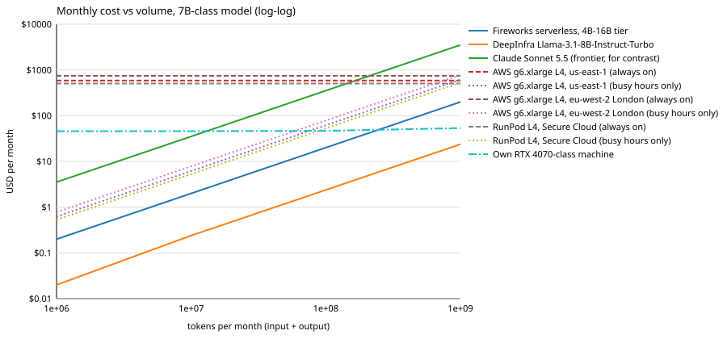

# Hosting options for a 7B-class code model

Added November 2026, after the original study. It is not part of the pre-registered protocol.

The question: what does it cost to serve a model like Qwen2.5-Coder-7B at 1M to 1B tokens a month,
and what else changes between running it yourself, renting a GPU and calling a per-token API?
Prices were read on 2026-11-22; each one has its source in
[configs/hosting_options.yaml](../configs/hosting_options.yaml). Throughput and GPU power come
from the serving benchmark on this machine ([results/serving_bench_v1](../results/serving_bench_v1/summary.md)).
The cost tables are generated by `scripts/hosting_cost.py`.

## Options and prices

| Option | Price | Basis | Source (read 2026-11-22) |
|---|---|---|---|
| Fireworks serverless, 4B–16B tier | $0.20 / 1M tokens, input and output | per token | [docs.fireworks.ai/serverless/pricing](https://docs.fireworks.ai/serverless/pricing) |
| DeepInfra Llama-3.1-8B-Instruct-Turbo | $0.02 in / $0.04 out per 1M | per token, different 8B model | [deepinfra.com/pricing](https://deepinfra.com/pricing) |
| Claude Sonnet 5.5 (frontier, for contrast) | $2 in / $10 out per 1M | per token | [platform.claude.com pricing](https://platform.claude.com/docs/en/about-claude/pricing) |
| AWS g6.xlarge (1x L4 24 GB), us-east-1 | $0.8048 / hour | on-demand instance | [AWS price list JSON](https://b0.p.awsstatic.com/pricing/2.0/meteredUnitMaps/ec2/USD/current/ec2-ondemand-without-sec-sel/US%20East%20(N.%20Virginia)/Linux/index.json) |
| AWS g6.xlarge, eu-west-2 London | $1.0216 / hour | on-demand instance, UK region | [AWS price list JSON](https://b0.p.awsstatic.com/pricing/2.0/meteredUnitMaps/ec2/USD/current/ec2-ondemand-without-sec-sel/EU%20(London)/Linux/index.json) |
| RunPod L4, Secure Cloud | $0.69 / hour | per pod, region not stated | [runpod.io/pricing](https://www.runpod.io/pricing) |
| Own RTX 4070-class machine | $1,600 over 36 months (assumption) + electricity at 26.32p/kWh | hardware + energy | [Ofgem price cap Oct–Dec 2026](https://www.ofgem.gov.uk/publications/changes-energy-price-cap-between-1-october-and-31-december-2026) |

Not used: Together AI lists no serverless 7–8B Qwen or Llama model (its nearest is Qwen3.5-9B at
$0.17 / $0.25). Groq shows no public price for its 8B model. The Google Cloud L4 price was only
available from a third-party aggregator, so it is left out.

## Cost model

Inputs, from [results/hosting_cost_v1/summary.md](../results/hosting_cost_v1/summary.md):

- Throughput: 724 tokens/s (input + output), measured for the 7B in Docker at 4 concurrent requests.
  With one request at a time it was 362 tokens/s.
- Workload: 450 input and 106 output tokens per call, the study's median for the 7B.
- GPU rental assumes the laptop's measured throughput carries over to an L4 (see Limitations).
- Own machine: GPU board power of 63 W busy and 6 W idle, both measured. The $1,600 hardware cost
  over 36 months is an assumption.

Monthly cost in USD:

| Option | 1M tokens | 10M | 100M | 1B | Per 1M tokens |
|---|---|---|---|---|---|
| DeepInfra Llama-3.1-8B (API) | $0.02 | $0.24 | $2.38 | $23.81 | $0.024 |
| Fireworks 4B–16B tier (API) | $0.20 | $2.00 | $20.00 | $200.00 | $0.200 |
| Claude Sonnet 5.5 (API, frontier) | $3.53 | $35.25 | $352.52 | $3,525 | $3.525 |
| RunPod L4, always on | $503.70 | $503.70 | $503.70 | $503.70 | $0.50 at 1B |
| AWS L4 us-east-1, always on | $587.50 | $587.50 | $587.50 | $587.50 | $0.59 at 1B |
| AWS L4 London, always on | $745.77 | $745.77 | $745.77 | $745.77 | $0.75 at 1B |
| RunPod L4, busy hours only (50% utilisation) | $0.53 | $5.29 | $52.93 | $529.28 | $0.529 |
| AWS L4 London, busy hours only (50% utilisation) | $0.78 | $7.84 | $78.36 | $783.64 | $0.784 |
| Own RTX 4070-class machine | $45.91 | $45.97 | $46.66 | $53.55 | $0.054 at 1B |

What this says, with these inputs:

- **Below about 100M tokens a month, a per-token API is cheapest by a wide margin.** An always-on
  rented L4 costs $500–750 a month whether it serves 1M tokens or 1B.
- **At the measured throughput, a rented L4 never beats a 7B API on price.** Beating Fireworks takes
  2.5–3.7B tokens a month. One GPU running Ollama can serve only about 1.9B tokens a month, even at
  100% load. Even billed per busy hour, it costs $0.53–0.78 per 1M tokens, which is 2.6–3.9 times
  Fireworks' price. DeepInfra's 8B price is another 8 times lower than Fireworks.
- **A rented GPU beats a frontier API above about 140–210M tokens a month.** That compares a 7B
  model with a much stronger one, so it matters only if the 7B is good enough for the task. In the
  study it solved 86% of the eval tasks.
- **An owned machine beats Fireworks above about 230M tokens a month,** under the hardware
  assumption. Electricity is small: the GPU draws 6 W idle and 63 W under load.
- **Throughput dominates the GPU rows.** Ollama on one laptop GPU barely gains from concurrent
  requests. With the 1.5B model, vLLM reached 2.4 times Ollama's peak output throughput at 16
  concurrent requests (732 vs about 300 tok/s), and was still climbing. Serving the 7B that way
  would cut the GPU cost per token by a similar factor, and lower every GPU break-even point by the
  same factor. The 7B was not measured in vLLM, so the table uses Ollama's throughput.
- The UK region costs 27% more than us-east-1 on AWS. None of the per-token APIs checked offers UK
  processing at all (see the privacy section).

## Licensing

- **Qwen2.5-Coder 1.5B and 7B Instruct**: Apache 2.0 ([1.5B card](https://huggingface.co/Qwen/Qwen2.5-Coder-1.5B-Instruct),
  [7B card](https://huggingface.co/Qwen/Qwen2.5-Coder-7B-Instruct)). Commercial use, modification and
  redistribution are allowed with the licence and notices kept. Not every Qwen2.5 size is Apache:
  Qwen2.5-Coder-3B uses the `qwen-research` licence and Qwen2.5-72B the `qwen` licence. Check the
  card of the exact size before shipping it.
- **Llama 3.1** ([Community License](https://dev.meta.ai/llama/llama3_1/license)): commercial use is
  allowed, but products above 700 million monthly active users need a separate licence from Meta.
  You have to show "Built with Llama", and a model trained on Llama outputs must start its name with
  "Llama". An [acceptable use policy](https://developer.meta.com/ai/llama3_1/use-policy) applies.
- **Gemma** ([terms of use](https://gemma.ai/resources/terms/)): a prohibited use policy applies and
  has to be passed on as an enforceable term when redistributing, along with a copy of the terms and
  a notice file. Google claims no rights in outputs. Gemma 4 has a separate licence that I did not check.
- A per-token API adds the provider's own terms on top of the model licence.

## Data privacy and UK GDPR

This is a summary of what the providers and the ICO publish, not legal advice.

- **Data leaving the device.** Self-hosting keeps prompts on hardware you control. With a rented GPU
  the cloud provider becomes a processor, but you choose the region (AWS London above). With a
  per-token API, prompts go to the provider and often on to its own infrastructure providers.
- **Processor contracts.** A controller that sends personal data to a provider needs an Article 28
  contract with it ([ICO: contracts between controllers and processors](https://ico.org.uk/for-organisations/uk-gdpr-guidance-and-resources/accountability-and-governance/contracts-and-liabilities-between-controllers-and-processors-multi/)).
  Anthropic publishes a [DPA](https://www.anthropic.com/legal/data-processing-addendum) that uses the
  ICO's international data transfer addendum. I found no public DPA for Fireworks, and could not
  confirm Together's. Ask them before sending personal data.
- **Residency and transfers.** None of the per-token APIs checked offers UK or EU processing.
  Fireworks says its servers are in the US. Anthropic offers `global` or `us` inference and US-only
  storage ([data residency](https://platform.claude.com/docs/en/manage-claude/data-residency)).
  Sending UK personal data to the US is a restricted transfer. It needs the UK–US data bridge (the
  recipient must be certified under it) or the IDTA / addendum
  ([ICO: international transfers](https://ico.org.uk/for-organisations/uk-gdpr-guidance-and-resources/international-transfers/)).
- **Logging and retention.** Fireworks says it does not store prompts or outputs for open models
  without opt-in, except for batch jobs
  ([data handling](https://docs.fireworks.ai/guides/security_compliance/data_handling)). DeepInfra
  says it does not store API data on disk or train on it
  ([data privacy](https://docs.deepinfra.com/account/data-privacy)). Anthropic does not retain API
  content by default, except for some model tiers, and keeps flagged content for longer
  ([retention](https://platform.claude.com/docs/en/manage-claude/api-and-data-retention)). On your
  own server you control this, including your own logs: Ollama does not log prompts by default, but
  a proxy or an application log might.
- **AI-specific guidance.** [ICO guidance on AI and data protection](https://ico.org.uk/for-organisations/uk-gdpr-guidance-and-resources/artificial-intelligence/guidance-on-ai-and-data-protection/).
  The ICO marks some of these pages as under review after the Data (Use and Access) Act 2025.

## Operations

- **Own GPU.** No per-token bill and full control, but you carry hardware failure, driver and CUDA
  updates, security patching and capacity planning. One 8 GB laptop GPU holds one 7B Q4 model, and
  only a few concurrent requests fit (see the benchmark).
- **Rented GPU.** Scales by adding instances, and the region is your choice. An always-on instance
  costs the same at 1M tokens as at 1B. Scaling to zero saves money but brings cold starts. Loading
  the 7B from local disk into VRAM took 3.5–5.6 s here, against a time to first token of under
  0.1 s once loaded. A new cloud instance would also have to pull the image and about 4.7 GB of
  weights first.
- **Per-token API.** No servers to run and no idle cost. In exchange you get the provider's rate
  limits, model versions that can change or be retired, prompts leaving your infrastructure, and a
  bill that grows linearly with volume.
- **Serving engine.** Ollama is simple to run and loads and unloads models on demand, which suits
  one machine with several models. vLLM keeps one model resident, reserves most of the VRAM up
  front and batches concurrent requests, which suits a dedicated GPU serving many users. On this
  8 GB GPU the two could not run at the same time.
- **Containers.** The Docker setup in this repo (`docker-compose.yml`) is the same unit you would run
  on a rented GPU host. Kubernetes was not tested here; it would add scheduling, health checks and
  rolling updates on top of the same image.

## Limitations

- Throughput was measured on one laptop GPU with Q4_K_M quantization and Ollama. A datacentre GPU
  with a batching server such as vLLM would give much higher throughput per GPU (vLLM with the
  1.5B already did here, see the README), so the GPU rows are pessimistic for high volumes.
- API prices are list prices for possibly different precision or model versions. DeepInfra's row is
  a different 8B model, and Sonnet is a much stronger model, included only as a price reference.
- Hardware cost and life for the own machine are assumptions. Energy covers the GPU board only.
- The benchmark repeats 5 prompts, so Ollama's prompt cache speeds up some prefills. Prefill is
  about 6% of GPU time per call in this workload, so this flatters throughput only slightly.
  Concurrent-request throughput also varied by up to ±30% between batches and between runs on this
  laptop.
- The workload mix (about 450 input and 106 output tokens per call) is this study's. Chat or
  long-document workloads have very different ratios.
