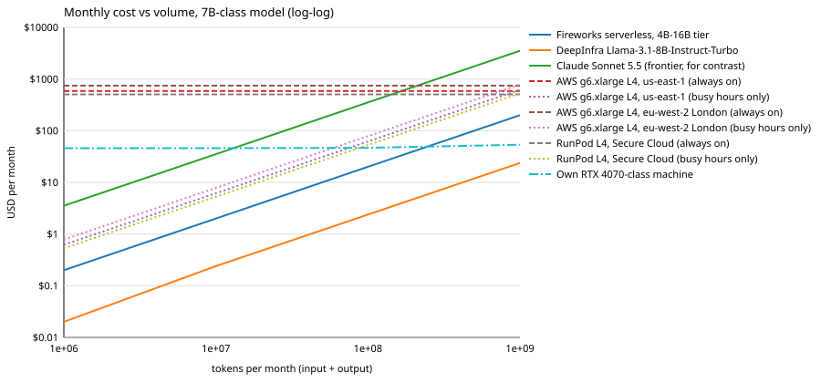

# Hosting cost model: hosting_cost_v1

Added November 2026, after the original study. Generated by scripts/hosting_cost.py from configs/hosting_options.yaml; prices, sources and access dates are in that file.

- Throughput: 724.26 total tokens/s (docker qwen2.5-coder:7b at concurrency 4, measured, results/serving_bench_v1/summary.csv)
- Workload mix: 450 input + 106 output tokens per call (median tokens per 7B call in results/eval_local_v1)
- Own GPU: $1600 over 36 months (assumption), 63.2 W busy / 5.73 W idle (GPU board only), $0.3474/kWh
- Busy-hours-only utilisation assumption: 50%

Monthly cost in USD (USD per 1M tokens in brackets):

| Option | 1e+06 tok/month | 1e+07 tok/month | 1e+08 tok/month | 1e+09 tok/month |
|---|---|---|---|---|
| Fireworks serverless, 4B-16B tier | $0.20 ($0.200) | $2.00 ($0.200) | $20.00 ($0.200) | $200.00 ($0.200) |
| DeepInfra Llama-3.1-8B-Instruct-Turbo | $0.02 ($0.024) | $0.24 ($0.024) | $2.38 ($0.024) | $23.81 ($0.024) |
| Claude Sonnet 5.5 (frontier, for contrast) | $3.53 ($3.525) | $35.25 ($3.525) | $352.52 ($3.525) | $3,525.18 ($3.525) |
| AWS g6.xlarge L4, us-east-1 (always on) | $587.50 ($587.504) | $587.50 ($58.750) | $587.50 ($5.875) | $587.50 ($0.588) |
| AWS g6.xlarge L4, us-east-1 (busy hours only) | $0.62 ($0.617) | $6.17 ($0.617) | $61.73 ($0.617) | $617.34 ($0.617) |
| AWS g6.xlarge L4, eu-west-2 London (always on) | $745.77 ($745.768) | $745.77 ($74.577) | $745.77 ($7.458) | $745.77 ($0.746) |
| AWS g6.xlarge L4, eu-west-2 London (busy hours only) | $0.78 ($0.784) | $7.84 ($0.784) | $78.36 ($0.784) | $783.64 ($0.784) |
| RunPod L4, Secure Cloud (always on) | $503.70 ($503.700) | $503.70 ($50.370) | $503.70 ($5.037) | $503.70 ($0.504) |
| RunPod L4, Secure Cloud (busy hours only) | $0.53 ($0.529) | $5.29 ($0.529) | $52.93 ($0.529) | $529.28 ($0.529) |
| Own RTX 4070-class machine | $45.91 ($45.905) | $45.97 ($4.597) | $46.66 ($0.467) | $53.55 ($0.054) |

Break-even: monthly volume above which a GPU's fixed monthly cost is lower than the API bill.

| GPU option | API option | GPU fixed $/month | Break-even tokens/month | One GPU can serve | Reachable on one GPU |
|---|---|---|---|---|---|
| AWS g6.xlarge L4, us-east-1 (always on) | Fireworks serverless, 4B-16B tier | $587.50 | 2.94e+09 | 1.90e+09 | no |
| AWS g6.xlarge L4, us-east-1 (always on) | DeepInfra Llama-3.1-8B-Instruct-Turbo | $587.50 | 2.47e+10 | 1.90e+09 | no |
| AWS g6.xlarge L4, us-east-1 (always on) | Claude Sonnet 5.5 (frontier, for contrast) | $587.50 | 1.67e+08 | 1.90e+09 | yes |
| AWS g6.xlarge L4, eu-west-2 London (always on) | Fireworks serverless, 4B-16B tier | $745.77 | 3.73e+09 | 1.90e+09 | no |
| AWS g6.xlarge L4, eu-west-2 London (always on) | DeepInfra Llama-3.1-8B-Instruct-Turbo | $745.77 | 3.13e+10 | 1.90e+09 | no |
| AWS g6.xlarge L4, eu-west-2 London (always on) | Claude Sonnet 5.5 (frontier, for contrast) | $745.77 | 2.12e+08 | 1.90e+09 | yes |
| RunPod L4, Secure Cloud (always on) | Fireworks serverless, 4B-16B tier | $503.70 | 2.52e+09 | 1.90e+09 | no |
| RunPod L4, Secure Cloud (always on) | DeepInfra Llama-3.1-8B-Instruct-Turbo | $503.70 | 2.12e+10 | 1.90e+09 | no |
| RunPod L4, Secure Cloud (always on) | Claude Sonnet 5.5 (frontier, for contrast) | $503.70 | 1.43e+08 | 1.90e+09 | yes |
| Own RTX 4070-class machine | Fireworks serverless, 4B-16B tier | $45.90 | 2.29e+08 | 1.90e+09 | yes |
| Own RTX 4070-class machine | DeepInfra Llama-3.1-8B-Instruct-Turbo | $45.90 | 1.93e+09 | 1.90e+09 | no |
| Own RTX 4070-class machine | Claude Sonnet 5.5 (frontier, for contrast) | $45.90 | 1.30e+07 | 1.90e+09 | yes |

