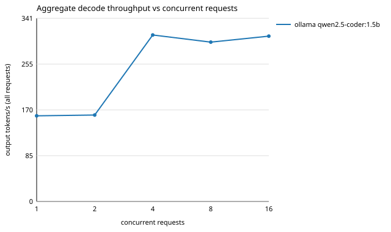

# Serving benchmark: serving_bench_ollama_oai_v1

Added November 2026, after the original study. Serving speed only, not repair quality.

- When (UTC): 2026-11-22T22:55:07Z
- GPU: NVIDIA GeForce RTX 4070 Laptop GPU, 8188 MiB, 621.01
- ollama: OpenAI-compatible server at http://127.0.0.1:11435, openai API (qwen2.5-coder:1.5b = None)
- Prompts: first-attempt repair prompts for the 5 dev tasks; temperature 0.0, num_predict 256, num_ctx 4096, 10 batches per concurrency level

| Target | Model | Concurrent | Requests | TTFT (median) | Decode tok/s per request | Client decode tok/s | Aggregate output tok/s | Aggregate total tok/s | Model VRAM (Ollama) | GPU peak (nvidia-smi) |
|---|---|---|---|---|---|---|---|---|---|---|
| ollama | qwen2.5-coder:1.5b | 1 | 10 | 0.045 s | 164.226 | 164.226 | 159.24 | 487.075 | n/a | 2672 MiB |
| ollama | qwen2.5-coder:1.5b | 2 | 20 | 0.046 s | 116.758 | 116.758 | 160.795 | 523.575 | n/a | 2672 MiB |
| ollama | qwen2.5-coder:1.5b | 4 | 40 | 0.043 s | 105.021 | 105.021 | 309.635 | 1118.01 | n/a | 2672 MiB |
| ollama | qwen2.5-coder:1.5b | 8 | 80 | 0.397 s | 100.324 | 100.324 | 296.335 | 1095.535 | n/a | 2672 MiB |
| ollama | qwen2.5-coder:1.5b | 16 | 160 | 2.708 s | 94.811 | 94.811 | 307.435 | 1103.1 | n/a | 2672 MiB |

TTFT is measured by the client (request sent to first streamed token). Decode tok/s is Ollama's eval_count / eval_duration where available (native API), otherwise the client value. Client decode tok/s is (output tokens - 1) / (wall time - TTFT), the same method for every server. Aggregate tok/s is all output tokens in a concurrent batch divided by the batch wall time (the total column also counts prompt tokens, which is what per-token APIs bill). GPU peak is total GPU memory in use, including the desktop.

