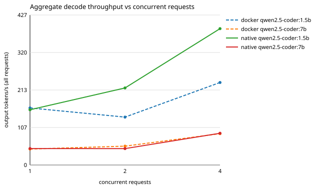

# Serving benchmark: serving_bench_v1

Added November 2026, after the original study. Serving speed only, not repair quality.

- When (UTC): 2026-11-22T22:29:51Z
- GPU: NVIDIA GeForce RTX 4070 Laptop GPU, 8188 MiB, 621.01
- docker: Ollama 0.40.0 at http://127.0.0.1:11435 (qwen2.5-coder:1.5b 1.5B Q4_K_M, qwen2.5-coder:7b 7.6B Q4_K_M)
- native: Ollama 0.40.0 at http://127.0.0.1:11434 (qwen2.5-coder:1.5b 1.5B Q4_K_M, qwen2.5-coder:7b 7.6B Q4_K_M)
- Prompts: first-attempt repair prompts for the 5 dev tasks; temperature 0.0, num_predict 256, num_ctx 4096, 10 batches per concurrency level

| Target | Model | Concurrent | Requests | TTFT (median) | Decode tok/s per request | Aggregate output tok/s | Aggregate total tok/s | Model VRAM (Ollama) | GPU peak (nvidia-smi) |
|---|---|---|---|---|---|---|---|---|---|
| docker | qwen2.5-coder:1.5b | 1 | 10 | 0.049 s | 168.03 | 162.4 | 491.855 | 1514 MiB | 2364 MiB |
| docker | qwen2.5-coder:1.5b | 2 | 20 | 0.042 s | 82.212 | 136.345 | 462.015 | 1514 MiB | 2364 MiB |
| docker | qwen2.5-coder:1.5b | 4 | 40 | 0.044 s | 93.68 | 234.8 | 776.685 | 1514 MiB | 2364 MiB |
| docker | qwen2.5-coder:7b | 1 | 10 | 0.087 s | 49.673 | 45.43 | 361.535 | 5200 MiB | 6346 MiB |
| docker | qwen2.5-coder:7b | 2 | 20 | 0.073 s | 40.425 | 53.655 | 453.415 | 5200 MiB | 6346 MiB |
| docker | qwen2.5-coder:7b | 4 | 40 | 0.077 s | 36.818 | 89.155 | 724.26 | 5200 MiB | 6346 MiB |
| native | qwen2.5-coder:1.5b | 1 | 10 | 0.059 s | 167.813 | 157.265 | 473.75 | 1514 MiB | 2507 MiB |
| native | qwen2.5-coder:1.5b | 2 | 20 | 0.047 s | 150.883 | 219.24 | 641.37 | 1514 MiB | 2507 MiB |
| native | qwen2.5-coder:1.5b | 4 | 40 | 0.059 s | 118.358 | 388.04 | 1189.52 | 1514 MiB | 2507 MiB |
| native | qwen2.5-coder:7b | 1 | 10 | 0.093 s | 51.203 | 46.815 | 383.04 | 5200 MiB | 6030 MiB |
| native | qwen2.5-coder:7b | 2 | 20 | 0.081 s | 26.507 | 46.71 | 396.58 | 5200 MiB | 6030 MiB |
| native | qwen2.5-coder:7b | 4 | 40 | 0.083 s | 35.975 | 90.395 | 684.69 | 5200 MiB | 6030 MiB |

TTFT is measured by the client (request sent to first streamed token). Decode tok/s is Ollama's eval_count / eval_duration. Aggregate tok/s is all output tokens in a concurrent batch divided by the batch wall time (the total column also counts prompt tokens, which is what per-token APIs bill). GPU peak is total GPU memory in use, including the desktop.

