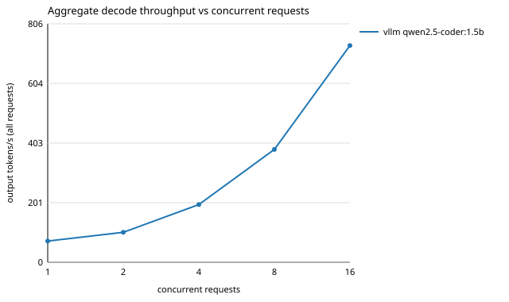

# Serving benchmark: serving_bench_vllm_v1

Added November 2026, after the original study. Serving speed only, not repair quality.

- When (UTC): 2026-11-22T22:51:53Z
- GPU: NVIDIA GeForce RTX 4070 Laptop GPU, 8188 MiB, 621.01
- vllm: vLLM 0.33.0 at http://127.0.0.1:8000, openai API (qwen2.5-coder:1.5b = Qwen/Qwen2.5-Coder-1.5B-Instruct)
- Prompts: first-attempt repair prompts for the 5 dev tasks; temperature 0.0, num_predict 256, num_ctx 4096, 10 batches per concurrency level

| Target | Model | Concurrent | Requests | TTFT (median) | Decode tok/s per request | Client decode tok/s | Aggregate output tok/s | Aggregate total tok/s | Model VRAM (Ollama) | GPU peak (nvidia-smi) |
|---|---|---|---|---|---|---|---|---|---|---|
| vllm | qwen2.5-coder:1.5b | 1 | 10 | 0.036 s | 72.448 | 72.448 | 71.695 | 237.35 | n/a | 6602 MiB |
| vllm | qwen2.5-coder:1.5b | 2 | 20 | 0.035 s | 71.887 | 71.887 | 101.19 | 354.0 | n/a | 6602 MiB |
| vllm | qwen2.5-coder:1.5b | 4 | 40 | 0.041 s | 70.76 | 70.76 | 194.89 | 731.86 | n/a | 6602 MiB |
| vllm | qwen2.5-coder:1.5b | 8 | 80 | 0.047 s | 69.351 | 69.351 | 381.265 | 1394.37 | n/a | 6602 MiB |
| vllm | qwen2.5-coder:1.5b | 16 | 160 | 0.055 s | 66.289 | 66.289 | 732.33 | 2671.525 | n/a | 6602 MiB |

TTFT is measured by the client (request sent to first streamed token). Decode tok/s is Ollama's eval_count / eval_duration where available (native API), otherwise the client value. Client decode tok/s is (output tokens - 1) / (wall time - TTFT), the same method for every server. Aggregate tok/s is all output tokens in a concurrent batch divided by the batch wall time (the total column also counts prompt tokens, which is what per-token APIs bill). GPU peak is total GPU memory in use, including the desktop.

